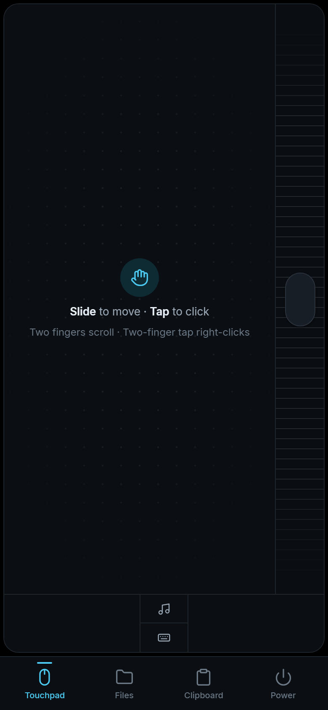
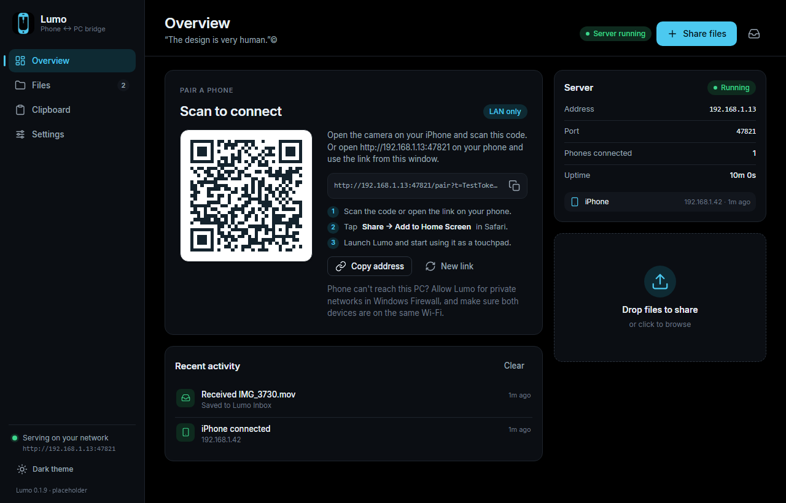

# Lumo

Basically two closed-source slow apps i used to pay for are now one free open-source ultrafast ultralightweight (17,6MB of disk space and consumes only 10MB of RAM HOLY MOLY) maintained candy for your enjoyment. 

Lumo is a small Rust + Tauri tray app that serves a private web app on your local network built by my slave army of AI agents and presumably me in two hours cuz i got fed up with the bullshit i was using.
Pair a phone with a QR code, add it to the Home Screen, and control the PC without any
cloud account or internet connection. You get a cool touchpad, near instant file transfer between devices and media controls.

| Phone | Desktop |
| --- | --- |
|  |  |

## Features

- **Touchpad** — relative pointer, tap to click, two-finger tap for right click,
  two-finger scroll, scroll rail with double-tap middle click, pointer speed, momentum and
  natural scrolling. A fading cyan trail follows your finger.
- **Clipboard** — text, images and files both ways, live WebSocket sync, plus a "send text
  to phone" box on the PC.
- **Files** — share files or whole folders from the PC (folders download as zips), stream
  uploads from the phone, auto-unpack zips, and open/reveal received files.
- **Media** — detects Windows media sessions (browsers/YouTube, Spotify, desktop players).
  Tap the centre music button to slide the player down over the touchpad; tap it again to
  close. It shows artwork, title, progress, previous/play-pause/next and ±10 s arrow seeks.
- **Power** — lock, sleep, restart and shut down from the phone, with a two-tap confirmation
  and an 8-second cancellable grace period for restart/shutdown.
- **Desktop app** — QR pairing, server status, activity feed, drag-and-drop sharing, tray
  menu, configurable port/inbox, autostart with Windows, light and dark themes.
- **Local only** — token-protected HTTP on your LAN. No account, no telemetry, no cloud.

## Install

1. Download the latest release and extract `Lumo.exe` and `WebView2Loader.dll` into a
   permanent folder (for example `C:\Apps\Lumo`).
2. Run `Lumo.exe`. Allow it through Windows Firewall for **private** networks.
3. Scan the QR code with your phone camera, open the link, then add Lumo to your Home Screen:
   - **Safari:** Tap **Share → Add to Home Screen**.
   - **Chrome:** Tap **⋮ → Add to Home Screen**.
4. Open the Lumo icon and use the four tabs: Touchpad, Files, Clipboard, Power.

Lumo works on iOS/iPadOS Safari and Android Chrome; any modern smartphone browser on the
same Wi-Fi should also work.

The app lives in the notification area. Closing the window hides it; use the tray menu to
open it again or quit. **Settings → Start Lumo when I sign in** enables autostart.

## Build

Requirements: Windows 10/11 x64, WebView2 Runtime, Rust 1.85+, and either MSVC build tools
or MinGW-w64.

```powershell
cargo build --release
# or, with the portable toolchain used during development:
powershell -ExecutionPolicy Bypass -File tools\build.ps1 -Release
```

Output: `target\release\lumo.exe` (plus `WebView2Loader.dll` for GNU builds). The release
zip contains both files.

## TO DO:

Lots.

## Security

The pairing link carries a 128-bit random token. Anyone with that link on your LAN can
control the pointer, clipboard, files and power actions. Use **Reset link** if a device is
lost, and never expose the port to the internet. Clipboard auto-sync can include passwords;
turn it off when needed.

## Project notes

- Version: **0.1.9** — name, logo and copy are placeholders.
- Design: **Blizzard Blue on black**; dark theme by default.
- Detailed development, architecture and API notes: [`docs/DEVELOPMENT.md`](docs/DEVELOPMENT.md).
- License: TBD.
